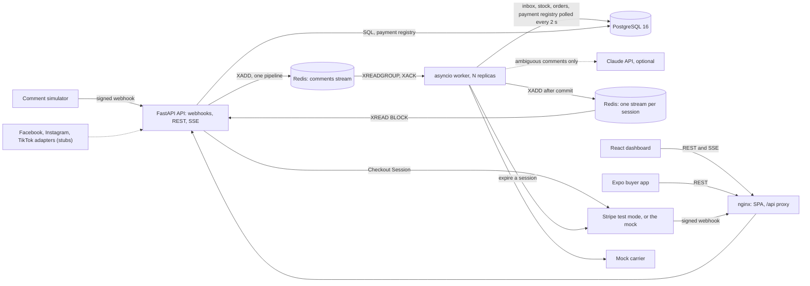

# LiveCart

LiveCart turns live-stream comments such as "SOLD A12 x2" into purchase intents, reserves the stock atomically and issues a short order reference.
Buyers pay with Stripe Checkout (test mode) in a white-label Expo app, while sellers follow intents, orders and stock in real time on a React dashboard.
A FastAPI API, an asyncio worker and a Redis Streams queue absorb comment spikes without ever overselling.

> **Personal demo project, fictional brand, not affiliated with any company.**

## Demo

**Demo GIF to be recorded.**

<!--
  Path: docs/assets/demo.gif (the file does not exist yet).
  What to record, on the compose stack of the quickstart: the seller signing in
  on http://localhost:8080; the "Friday drop" live view while the simulator's
  comments come in (intents, orders with their countdown, stock going down);
  one order paid on the mock provider's page, from the buyer app or with the
  curl steps of CONTRIBUTING.md#payments, turning paid on the dashboard; then
  its shipment moving on. Replace the line above with
   once the file is committed.
-->

## Quickstart

With Docker (Docker Desktop with the WSL 2 backend on Windows):

```bash
git clone <url> livecart && cd livecart
cp .env.example .env
docker compose up --build
```

Then open:

| What                                           | Where                                                                                                                                                                                                  |
| ---------------------------------------------- | ------------------------------------------------------------------------------------------------------------------------------------------------------------------------------------------------------ |
| The seller dashboard                           | <http://localhost:8080>: sign in as `demo-seller@livecart.test` with the `SEED_DEMO_PASSWORD` of `.env` (`change-me-demo-seller`, as `.env.example` sets it), then open the live view of "Friday drop" |
| The interactive API documentation              | <http://127.0.0.1:8000/docs>, in development only                                                                                                                                                      |
| The demo storefront, as the buyer app reads it | <http://localhost:8080/api/v1/storefronts/demo-seller>                                                                                                                                                 |
| The buyers' messages (reference, token, link)  | `docker compose run --rm simulator --text --no-follow`                                                                                                                                                 |
| A payment, a shipment, the buyer app           | [CONTRIBUTING.md](CONTRIBUTING.md#payments): one mock payment with curl; [Buyer app](CONTRIBUTING.md#buyer-app): Expo Go on a phone of the same network                                                |

The "Friday drop" session is live, and the simulator comments on it from the start, one comment every 5 s on average ([CONTRIBUTING.md](CONTRIBUTING.md#comment-simulator)). The stack needs no third-party key: payments go through the mock provider and shipments through the mock carrier. To try the LLM fallback, set `ANTHROPIC_API_KEY` in `.env` (the always-on simulator then spends the daily budget; `docker compose stop simulator` pauses it). Stripe in test mode needs your own test keys and the `stripe` compose profile ([CONTRIBUTING.md](CONTRIBUTING.md#payments)).

The copy of `.env.example` is the one step before `docker compose up`: `compose.yaml` gives no default to any secret and refuses to start without them, so that no password ever has a default value in a versioned file. The `change-me-*` values are development placeholders, refused when `APP_ENV=production`. `docker compose down --volumes` (or `make reset`) removes the stack and its data.

## Architecture



A comment is acknowledged as soon as it is queued: the webhook checks its signature, puts it on a Redis stream and answers 202, without touching PostgreSQL. A worker then claims it in a PostgreSQL inbox, so that a comment counts once whatever its deliveries, reads it with the parser (and Claude only for an ambiguity), reserves the stock with one conditional `UPDATE` and opens the order, then publishes the change to the session's stream, which the API relays to the seller over SSE. [docs/INTERVIEW_NOTES.md](docs/INTERVIEW_NOTES.md#le-parcours-complet-dun-commentaire) (in French) follows one comment through the code, file by file.

The Python code is layered, and imports only go inwards ([ADR 0002](docs/adr/0002-layered-architecture-ports-and-state-machines.md)); an architecture test fails on any import that breaks the rule of the two inner layers:

- **domain** (`livecart_core.domain`): value objects, state machines and the parser, standard library only;
- **application** (`livecart_core.application`): the ports, the data that crosses them and the use cases, with pydantic;
- **infrastructure** (`livecart_core.infrastructure`): the SQL repositories, the Redis queue, session streams, idempotency store, rate limiter and LLM budget, the platform adapters, the payment providers, the carriers, argon2id and the clock;
- **entry points** (`livecart_api`, `livecart_worker`, the CLIs): routes, loops and the wiring of the adapters; the worker also holds the Claude adapter, the one module that needs the Anthropic SDK.

| Service      | Role                                                                       | Published on                              |
| ------------ | -------------------------------------------------------------------------- | ----------------------------------------- |
| `web`        | nginx: the dashboard, and the API proxied on `/api/`                       | `8080` (every interface, for a LAN phone) |
| `api`        | FastAPI behind uvicorn                                                     | `127.0.0.1:8000`                          |
| `worker`     | asyncio worker: comments, reclaim, expiry sweep, payment events, shipments | not published                             |
| `simulator`  | comment simulator on the demo session                                      | not published                             |
| `migrate`    | one-shot Alembic upgrade, as the schema owner                              | not published                             |
| `seed`       | one-shot demo data, created only where missing                             | not published                             |
| `postgres`   | PostgreSQL 16, databases `livecart` and `livecart_test`                    | `127.0.0.1:55432`                         |
| `redis`      | Redis 8 with a password, append-only file                                  | `127.0.0.1:56379`                         |
| `stripe-cli` | `stripe` profile only: Stripe's events forwarded to the API through nginx  | not published                             |
| `k6`         | `loadtest` profile only: the comment spike of `make load-test`             | not published                             |

## Features

### From comment to order

- **Comment ingestion**: one signed webhook per platform, `POST /api/v1/webhooks/comments/{platform}`, in a common format (`IncomingComment`), its HMAC-SHA256 signature checked before the body is read. The simulator's adapter is real; Facebook, Instagram and TikTok are documented stubs that refuse to start. A batch goes to a Redis stream in one pipeline and gets 202, or 503 with `Retry-After` once the workers' backlog reaches `QUEUE_MAX_DEPTH` ([ADR 0004](docs/adr/0004-redis-streams-queue-and-leased-inbox.md)).
- **Worker**: a consumer group reads the stream; a PostgreSQL inbox with a lease per delivery makes every comment count once; idle deliveries are reclaimed after 120 s and dead-lettered after 3 deliveries ([ADR 0004](docs/adr/0004-redis-streams-queue-and-leased-inbox.md)).
- **Intent parsing**: a deterministic French and English parser (codes, variants, quantities, typos, emojis), held to a corpus of 200 comments. With `ANTHROPIC_API_KEY` set, the comments it leaves ambiguous go to Claude (`claude-opus-5` at low effort) in structured outputs, once per comment, under a budget shared in Redis (200 calls per session, $1.00 a day) and 4 slots per worker; the domain checks the answer against the catalog before anything is reserved. Without a key, everything runs on the parser alone ([ADR 0006](docs/adr/0006-deterministic-parser-then-llm-fallback.md)).
- **Reservation**: one conditional `UPDATE` in a READ COMMITTED transaction, and one pending order per buyer and product; `test_reservation_concurrency.py::test_a_thousand_concurrent_reservations_never_oversell` sends 1,000 concurrent reservations at 200 units, three times over. Every 5 s, the reservations nobody paid expire and their stock is for sale again ([ADR 0005](docs/adr/0005-anti-oversell-conditional-update.md)).
- **Order references and tokens**: `LC-` and six Crockford symbols, drawn again after a collision, and an access token derived by HMAC and stored as a hash only. The reference alone shows an order's status; its details, address, checkout and tracking need the token ([ADR 0007](docs/adr/0007-order-reference-and-hmac-access-token.md)).

### Payment and shipping

- **Payment provider**: one `PaymentProvider` port. The mock is the default and needs no account; Stripe Checkout runs in test mode with your own test keys; PayPal and Viva are documented stubs. A checkout extends the reservation to at least now + `PAYMENT_GRACE_SECONDS` (600 s), 3 attempts per order at most ([ADR 0008](docs/adr/0008-payments-provider-port-hosted-checkout-expire-first.md)).
- **Webhooks and expire-first**: a payment webhook is checked, reduced to an allow-list and recorded once in PostgreSQL, with Redis up or down; the workers apply that registry every 2 s. The sweep never releases the stock of a payment in flight before the provider has expired its session ([ADR 0008](docs/adr/0008-payments-provider-port-hosted-checkout-expire-first.md)).
- **Shipments**: one `CarrierProvider` port and a stateless mock carrier, whose parcel moves one step every 120 s, to `delivered` six minutes after the payment; DPD, Chronopost and DHL are documented stubs. The buyer follows the parcel with the order's token ([ADR 0002](docs/adr/0002-layered-architecture-ports-and-state-machines.md)).

### Seller dashboard (React, Vite)

- **Sign-in**: the access token in the tab's memory only, the HttpOnly refresh cookie traded for a new one on a reload, one refresh at a time across tabs under a Web Lock ([ADR 0017](docs/adr/0017-dashboard-auth-and-event-stream-client.md)).
- **Sessions and products**: one form for a session and its products, typed against the generated request bodies; restocks by delta under an `Idempotency-Key`; "Start live" and "End live" along the session's state machine.
- **Live view**: the session's SSE stream, read with `fetch` and resumed with `Last-Event-ID`: stock per product, orders with their reservation countdown and shipment, intents with an "AI" badge for the LLM's, rejected comments by reason. A pure reducer applies each event by upsert, so a duplicate changes nothing ([ADR 0009](docs/adr/0009-realtime-sse-over-a-redis-stream-per-session.md)). The built SPA runs under `default-src 'self'`, with no inline script and no `eval`.

### Buyer app (Expo, white label)

- **Brands**: one folder per brand in `apps/mobile/brands/`, its `brand.json` checked by a strict zod schema in `app.config.ts`, so that a broken brand never builds; one EAS profile per brand. Two brands: LiveCart Demo (scheme `livecart`) and Pomelune, an invented name (scheme `samplelive`) ([ADR 0013](docs/adr/0013-white-label-brand-config-eas-profiles-design-tokens.md)).
- **Screens**: the brand's live storefront ("Store not found" on a 404); my orders, whose tokens live in `expo-secure-store` only, 50 at most; "Add order" (the reference and token the simulator prints); a buyer link, `<scheme>://link/LC-XXXXXX#t=<token>`, whose fragment no server receives; the order's detail and tracking; the payment in an auth session, then a payment return that reads the order's status for 60 s at most. A token, typed or linked, is checked with the API before it is stored.

### Platform

- **Seller auth**: argon2id, access tokens of 15 minutes, rotating refresh tokens in an HttpOnly cookie with a 30 s grace between tabs; accounts opened by `livecart-create-seller`, no public sign-up ([ADR 0010](docs/adr/0010-seller-auth-short-jwt-rotating-refresh-argon2id.md)).
- **Perimeter**: one origin through nginx, the only trusted proxy; rate limits in Redis per address, seller, account and token; security headers; least-privilege PostgreSQL roles; non-root, read-only containers ([ADR 0011](docs/adr/0011-perimeter-and-hardening.md)). [SECURITY.md](SECURITY.md) reviews the code against the OWASP API Security Top 10.
- **API contract**: the OpenAPI document exported from FastAPI and the TypeScript client generated from it, shared by the dashboard and the buyer app, committed and checked for drift in CI ([ADR 0012](docs/adr/0012-api-contract-openapi-and-generated-typescript-client.md)).
- **Observability**: JSON logs with request and correlation ids, `/health` and `/ready`, and Prometheus metrics on each process's internal port 9100, published nowhere ([ADR 0014](docs/adr/0014-observability-structlog-ids-and-internal-metrics.md)).
- **Quality**: ruff, mypy `--strict`, pytest with an 80 % branch coverage gate on the domain and the application, ESLint, Prettier and strict TypeScript, Vitest and Jest, git hooks (lefthook, commitlint, gitleaks), and a CI with dependency, secret and image scans and every action pinned by SHA ([ADR 0015](docs/adr/0015-quality-tooling-and-supply-chain.md)).
- **Load test**: a k6 comment spike in a compose profile, `make load-test`, with its `no_oversell` check ([Performance](#performance)).

## Key decisions and trade-offs

Every record is in [`docs/adr/`](docs/adr/README.md).

| Decision                                                                                                                                                                      | Trade-off                                                                                                                                                                                |
| ----------------------------------------------------------------------------------------------------------------------------------------------------------------------------- | ---------------------------------------------------------------------------------------------------------------------------------------------------------------------------------------- |
| One `cp .env.example .env` before `docker compose up`, since `compose.yaml` requires every secret ([ADR 0011](docs/adr/0011-perimeter-and-hardening.md))                      | One extra command, so that secrets never have a default in a versioned file                                                                                                              |
| pnpm and uv workspaces, one lockfile per ecosystem, no orchestrator ([ADR 0001](docs/adr/0001-monorepo-workspaces-and-runtime-versions.md))                                   | Two package managers; each version has copies in several files, which `pnpm run check:pins` checks                                                                                       |
| Protocol ports with in-memory fakes, hand-written state machines ([ADR 0002](docs/adr/0002-layered-architecture-ports-and-state-machines.md))                                 | The fakes hold rules the SQL adapters must match, so both run the same contract tests; every rule is tested without Docker                                                               |
| FastAPI with SQLAlchemy Core, no ORM; one Python image for the API, the worker, migrate and seed ([ADR 0003](docs/adr/0003-backend-stack-fastapi-sqlalchemy-core-alembic.md)) | No lazy loading or identity map, and a schema change is two edits that a test compares; migrations always ship with the code that uses them                                              |
| Redis Streams with backpressure on the backlog, and a leased PostgreSQL inbox ([ADR 0004](docs/adr/0004-redis-streams-queue-and-leased-inbox.md))                             | Delivery is at least once and the inbox makes it harmless; after a worker crashes, its comments wait about two minutes for a reclaim                                                     |
| One conditional `UPDATE` reserves the stock, in READ COMMITTED ([ADR 0005](docs/adr/0005-anti-oversell-conditional-update.md))                                                | Reservations of one product wait on its row lock; none oversells, and a long burst on one product can pass the 2 s lock timeout, which costs a retry                                     |
| A deterministic parser first, Claude only for its ambiguities, behind a budget and 4 slots per worker ([ADR 0006](docs/adr/0006-deterministic-parser-then-llm-fallback.md))   | A phrasing the lexicon misses is rejected or costs a model call; a comment past the budget or the slot wait is a missed sale rather than a late one                                      |
| A public reference, and an access token derived by HMAC for the rest ([ADR 0007](docs/adr/0007-order-reference-and-hmac-access-token.md))                                     | The buyer keeps two things; a leak of `ORDER_TOKEN_KEY` would expose every token, and its rotation is not implemented                                                                    |
| A hosted checkout, expire-first, and a PostgreSQL registry of webhooks the workers poll ([ADR 0008](docs/adr/0008-payments-provider-port-hosted-checkout-expire-first.md))    | Up to 2 s before an order shows paid, and a payment in flight keeps its stock while the provider is out of reach; a payment is never applied twice, nor lost to a Redis or worker outage |
| SSE over a Redis stream per session, published after commit ([ADR 0009](docs/adr/0009-realtime-sse-over-a-redis-stream-per-session.md))                                       | Best effort: an event lost to a Redis failure is caught up from the next snapshot, never retried                                                                                         |
| Access tokens of 15 minutes, rotating refresh tokens with a 30 s grace ([ADR 0010](docs/adr/0010-seller-auth-short-jwt-rotating-refresh-argon2id.md))                         | An access token lives until it expires; tabs racing on one refresh token keep the seller signed in                                                                                       |
| One origin through nginx, rate limits in Redis, logins closed while it is down ([ADR 0011](docs/adr/0011-perimeter-and-hardening.md))                                         | A Redis outage refuses new logins; fixed windows let a burst of up to twice a limit through at their edge                                                                                |
| The OpenAPI document and the generated client committed, checked for drift in CI ([ADR 0012](docs/adr/0012-api-contract-openapi-and-generated-typescript-client.md))          | Generated files in the repository, regenerated with `make gen-api` at every API change; no type is written twice                                                                         |
| One folder per brand checked by `app.config.ts`, one EAS profile per brand ([ADR 0013](docs/adr/0013-white-label-brand-config-eas-profiles-design-tokens.md))                 | A broken brand never builds; every brand is an Expo project and a store listing of its own                                                                                               |
| Metrics on an internal port only ([ADR 0014](docs/adr/0014-observability-structlog-ids-and-internal-metrics.md))                                                              | Nothing outside the container network can read them, nor anyone until a scraper runs beside the containers                                                                               |
| Scans on every change and weekly, actions pinned by SHA ([ADR 0015](docs/adr/0015-quality-tooling-and-supply-chain.md))                                                       | A newly published advisory turns CI red without any change in the repository, by design                                                                                                  |
| Render as the target host, designed, not executed ([ADR 0016](docs/adr/0016-target-hosting-render-designed-not-executed.md))                                                  | Nothing is deployed; executing the design needs a production notifier first, and ties the deployment to one vendor's Blueprint format                                                    |
| The dashboard's token in memory, one refresh at a time across tabs, the stream read with `fetch` ([ADR 0017](docs/adr/0017-dashboard-auth-and-event-stream-client.md))        | Each reload and new tab costs a refresh; on plain HTTP to a LAN address there are no Web Locks, and tabs fall back on the API's 30 s grace                                               |

## Performance

On 2026-10-02, three runs of the k6 comment spike on one laptop (a 12th Gen Intel Core i7-1255U, whose Docker engine saw 12 CPUs and 7.6 GiB) each sent 1,000 signed comment webhooks for one product with 200 in stock, peaking at 80 calls a second. Every call got its 202, every run ended with exactly 200 units reserved and passed `no_oversell`, and the queue was empty at the first reading, 40 s after the burst. The webhook's acknowledgement latency (`webhook_duration`, the median of the three runs' values) was **2.76 ms at p50, 4.01 ms at p95 and 5.95 ms at p99**.

That latency is the acknowledgement only: the signature, the rate limit and the enqueue in Redis, not the reservation the worker makes later. k6 and the stack shared the laptop, with one API process and one worker capped at 1 CPU each, and k6 posted to the API directly, not through nginx. These figures describe that laptop on that evening: they are not a capacity claim. [docs/PERFORMANCE.md](docs/PERFORMANCE.md) gives the machine, the configuration, the scenario, every run and the limits, quoted from the summaries in [`loadtest/results/`](loadtest/results/).

## Status / what is verified

All nine milestones of the plan are built. What has run, and what has not:

- **Run on the development PC**: the compose stack of the quickstart; the mock payment flow to `paid` in the seller's SSE stream; a paid order's shipment to `delivered`; the dashboard's live view, and its stream resuming after `docker compose restart api`, in the coding agent's browser pane; the three load test runs above; for the buyer app, its tests, type checks, expo-doctor and an Android `expo export` of both brands. [CONTRIBUTING.md](CONTRIBUTING.md#milestone-log) records each milestone's end criterion, what was run and when.
- **Not run on a device, nor with EAS**: the buyer app has never run on a phone, an emulator or Expo Go, and no EAS build exists (`eas init`, the Android development build), so the buyer links and the payment return have never run on a device. The plan's end criterion of milestone 8 is not met; it needs a phone and an Expo account.
- **iOS is configured, not built**: bundle identifiers and an iOS simulator build in the base EAS profile, no build.
- **Stripe's test card 4242 has not paid an order**: it needs the owner's own Stripe test keys in `.env`. The Stripe adapter is tested against `FakeStripeApi`, an in-memory stand-in of its API, and never reached Stripe; the end criterion of milestone 5 is half met (the mock's flow ran).
- **The LLM fallback has never called Anthropic's API**, and `scripts/llm_eval.py` has not run: there is no key.
- **The deployment is designed, not executed** ([docs/DEPLOYMENT.md](docs/DEPLOYMENT.md)): no `render.yaml`, no deploy workflow, no image pushed, and the worker refuses `APP_ENV=production` until a notifier delivers on the platforms.
- **CI is defined but has never run**: the repository has no remote yet, so `.github/workflows/ci.yml` has not run on GitHub. `make lint` and `make test` run the checks of its `python` and `node` jobs locally; `pnpm run check:openapi` and `pnpm run smoke:compose` run its drift check and its compose smoke test by hand.
- **Trivy runs in CI only**: no `make` target or git hook runs it, so its filesystem and image scans wait for the first CI run.

The test suites, counted on 2026-10-02: 3,549 pytest tests (3,132 unit tests and 417 integration tests, which need the compose PostgreSQL and Redis), 66 Vitest tests of the dashboard, 116 Jest tests of the buyer app and 44 `node:test` tests of the root scripts. `make test` runs them all.

| Milestone  | What it added                                                                                           |
| ---------- | ------------------------------------------------------------------------------------------------------- |
| 1          | Monorepo, quality tooling, CI, Docker stack, the generated API client                                   |
| 2          | Domain value objects, state machines and the deterministic parser with its corpus                       |
| 3          | Schema and migrations, seller auth, sessions and products, atomic reservation, references, buyer lookup |
| 4a, 4b, 4c | Comment ingestion, queue and worker; real-time SSE; the optional LLM fallback                           |
| 5          | Payment provider port, mock and Stripe Checkout, webhook registry, expire-first                         |
| 6          | Carrier port, mock carrier, shipments and tracking                                                      |
| 7          | Seller dashboard                                                                                        |
| 8          | White-label buyer app and design tokens                                                                 |
| 9          | k6 load test and measured results, security policy, deployment guide, final documentation               |

## Out of scope

- Real Facebook, Instagram and TikTok integrations: their adapters are documented stubs that stop the API at startup when enabled.
- PayPal and Viva Wallet payments, DPD, Chronopost and DHL shipments: documented stubs that stop the process at startup when selected.
- Buyer accounts: a buyer holds a reference and a token per order.
- Comments about several products, rejected as `multiple_products`; several currencies, since `DEFAULT_CURRENCY` is one per deployment.
- Cancellation by the seller and refunds: a `paid_after_expiry` order is refunded by hand ([runbook](docs/runbooks/paid-after-expiry.md)).
- An automatic purge of personal data ([SECURITY.md](SECURITY.md#retention-policy)).
- Universal Links and App Links: buyer links use the brand's own scheme.
- iOS builds, and real time in the buyer app, which reads the API when a screen opens and polls an order only on the payment return.
- A real deployment.

## Roadmap

- **Run what is built but not yet proven**: a Stripe test payment with the 4242 card, `scripts/llm_eval.py` with a key, the buyer app on an Android phone and its development build, the first CI run once the repository has a remote.
- **Reliability and data**: an outbox for the SSE events, PgBouncer, a purge job running as the migrator, a CI job on Valkey.
- **Security**: sliding windows for the rate limits, rotation of the JWT key and of `ORDER_TOKEN_KEY`, Universal Links and App Links, Dependabot.
- **Payments**: a `refunded` status and a "Mark refunded" action, then refunds through Stripe's API; the Payment Sheet in the app.
- **LLM**: budget limits per seller and per minute, reserving a call's worst case before it; a model change only after `scripts/llm_eval.py`.
- **Observability**: a Prometheus scraper, Grafana and OpenTelemetry traces.
- **Product**: resending the buyer's link; design tokens shared with the dashboard.
- **Delivery**: images pushed to GHCR and a manual deploy workflow, once a production notifier exists.
- **Tests and upgrades**: Maestro and Playwright; TypeScript 7, Node 26 LTS, Jest 30, Expo SDK 58.

## Documentation

- [CONTRIBUTING.md](CONTRIBUTING.md): prerequisites, `make` targets with their raw commands for PowerShell, the simulator, payments, shipments, the buyer app, the load test, commit conventions and the milestone log.
- [SECURITY.md](SECURITY.md): how to report a vulnerability, the OWASP API Security Top 10 review, the endpoint inventory, the retention policy and the known limits.
- [docs/PERFORMANCE.md](docs/PERFORMANCE.md): the measured load test.
- [docs/DEPLOYMENT.md](docs/DEPLOYMENT.md): the deployment on Render, designed, not executed.
- [docs/adr/](docs/adr/README.md): the 17 architecture decision records.
- [docs/runbooks/paid-after-expiry.md](docs/runbooks/paid-after-expiry.md): refunding a payment that came after its order expired.
- [docs/INTERVIEW_NOTES.md](docs/INTERVIEW_NOTES.md): the architecture, the path of a comment, the trade-offs and likely interview questions, in French.

## License

[MIT](LICENSE)
