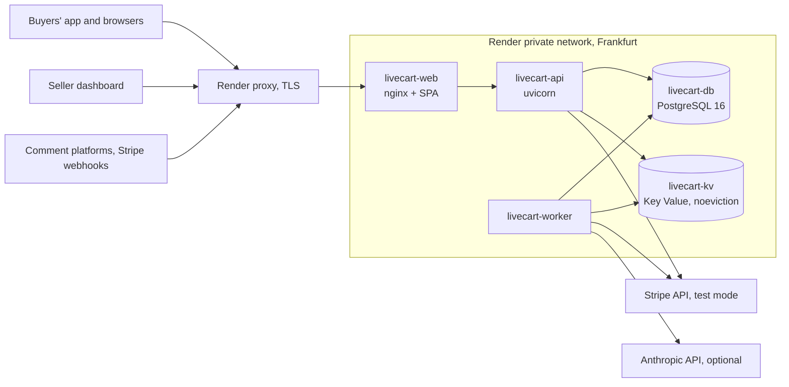

# Deployment on Render

> **Designed, not executed.** Nothing in this document has been run. The repository holds no `render.yaml`, no deploy workflow and no registry push: CI builds and scans the two images, and never pushes them (`.github/workflows/ci.yml`). This is decision 6 of the project plan, recorded in [ADR 0016](adr/0016-target-hosting-render-designed-not-executed.md). Every statement about LiveCart below comes from its code; every statement about Render is a design assumption, and the ones that decide whether the design works are listed under [Platform facts to confirm](#platform-facts-to-confirm) for whoever executes it.

## What blocks an execution today

- **The worker does not start with `APP_ENV=production`.** The only buyer notifier, `SimulatedBuyerNotifier`, writes each order's reference, access token and link to a development Redis stream, and refuses to be built in production (`livecart_core.infrastructure.notifier`, ADR 0007). A production worker needs a notifier that delivers on the platforms themselves; none exists, since the platform integrations are out of scope. Running the stack with `APP_ENV=development` on a public host is not a way around it: development accepts the `change-me` placeholders, the mock payment provider and Expo Go's `exp://` return URLs, and serves the Swagger UI.
- **Payments are Stripe test mode only.** In production the mock provider is refused (`refuse_mock_payments_in_production`), and `STRIPE_SECRET_KEY` must be a test key (`sk_test_` or `rk_test_`; a live key is refused at startup). The Stripe adapter has only run against `FakeStripeApi`, an in-memory stand-in (ADR 0008).
- **No image is published.** The design deploys images tagged `sha-<7>` from GHCR, pushed by a manual deploy workflow behind a `production` environment; neither exists.
- **The nginx configuration is the compose one.** `infra/nginx/default.conf` resolves `api` through Docker's embedded DNS (`127.0.0.11`) and trusts no proxy in front of it. Render needs a second static file, described in [Client addresses and the proxy](#client-addresses-and-the-proxy).

## Why Render

- **Managed containers from the existing images.** LiveCart ships two images: `infra/docker/python.Dockerfile` (API, worker, `livecart-migrate`, one artifact so the migrations always come from the code that uses the schema) and `infra/docker/web.Dockerfile` (the built dashboard behind nginx-unprivileged). Render runs prebuilt images as public web services, private services and background workers, with a private network between them, health-checked zero-downtime deploys and a pre-deploy command: everything compose does here, without a VM or a cluster to run.
- **PostgreSQL 16 and a Redis-compatible store, managed.** The schema targets PostgreSQL 16 (compose runs `postgres:16.15-alpine`). The comment queue needs a store that refuses writes rather than evicting entries: Render's Key Value takes `maxmemoryPolicy: noeviction`, the policy compose gives Redis (ADR 0004). Managed PostgreSQL brings backups and point-in-time recovery.
- **Frankfurt.** The buyers' shipping addresses and the sellers' accounts stay in the EU, and the region is close to a French-speaking audience.
- **Little to operate for one person.** No OS to patch, TLS certificates issued and renewed by the platform, logs and metrics of each service in one dashboard, a rollback to a previous deploy from the same place. The cost is a dependency on one vendor's Blueprint format, kept small by keeping the images platform-neutral.

The alternatives (a VPS with compose, Fly.io, AWS ECS on Fargate with RDS and ElastiCache, Kubernetes) are weighed in ADR 0016.

## Services



| Service           | Render type          | Runs                                                                                          | Health check                  | Notes                                                                                                |
| ----------------- | -------------------- | --------------------------------------------------------------------------------------------- | ----------------------------- | ---------------------------------------------------------------------------------------------------- |
| `livecart-web`    | Web service (public) | `livecart-web:sha-<7>`, nginx on 8080                                                         | `/healthz`, answered by nginx | The only public entry point, as in compose: the SPA, and `/api/` and `/health` forwarded to the API. |
| `livecart-api`    | Private service      | `livecart-python:sha-<7>`, the image's command (`uvicorn livecart_api.main:app` on port 8000) | `/health`                     | Pre-deploy command `livecart-migrate upgrade head`. Two instances or more: each is stateless.        |
| `livecart-worker` | Background worker    | `livecart-python:sha-<7>`, command `livecart-worker`                                          | none (see below)              | Stateless consumers of one group: add instances to drain the queue faster.                           |
| `livecart-db`     | PostgreSQL 16        |                                                                                               |                               | No external connections (`ipAllowList: []`) once bootstrapped.                                       |
| `livecart-kv`     | Key Value            |                                                                                               |                               | `maxmemoryPolicy: noeviction`, no external connections.                                              |

Not deployed: the comment simulator and the seed (both demo tools; the simulator refuses `APP_ENV=production`), the Stripe CLI (Stripe calls the public webhook URL itself), and compose's one-shot `migrate` service, replaced by the pre-deploy command.

Each process keeps its compose sizing: one uvicorn process per container, the worker's pool of `WORKER_CONCURRENCY + 4 + 2` connections (22 by default) and the API's pool of 5 + 10. The sum over all instances, 15 per API and 22 per worker, must stay within the connection limit of the database plan, as it stays within 97 in compose.

## Environment variables

Derived from `livecart_core.settings` (`Settings` for the API and the worker, `MigrationSettings` for `livecart-migrate`) and `.env.example`, whose comments give every bound. "Secret" means the value is a `SecretStr` in `Settings` or embeds a password: it goes in with `sync: false` and is typed in the Render dashboard, never committed. Every `SecretStr` that still holds `change-me` stops the process at startup when `APP_ENV=production`.

"Required" reads: **yes**, no default, the process refuses to start without it; **on Render**, the default suits compose and must be replaced; **if ...**, required under that condition; **no**, the default stands.

### Shared by the API and the worker

| Name                                                                      | Role                                                                                                                                        | Required                                    | Secret   |
| ------------------------------------------------------------------------- | ------------------------------------------------------------------------------------------------------------------------------------------- | ------------------------------------------- | -------- |
| `APP_ENV`                                                                 | `production`: refuses placeholders and the mock payment provider, serves no `/docs` nor `/openapi.json`, sets the `Secure` cookie attribute | on Render (default `development`)           | no       |
| `LOG_LEVEL`                                                               | Level of the JSON logs on stdout                                                                                                            | no (`INFO`)                                 | no       |
| `DATABASE_URL`                                                            | PostgreSQL as `livecart_app` (SELECT, INSERT, UPDATE only), `postgresql+asyncpg://` only                                                    | yes                                         | yes      |
| `REDIS_URL`                                                               | Key Value, `redis://` or `rediss://`                                                                                                        | yes                                         | yes      |
| `REDIS_KEY_PREFIX`                                                        | First segment of every key                                                                                                                  | no (`livecart`)                             | no       |
| `JWT_SECRET`                                                              | Signs the sellers' access tokens (HS256), at least 32 bytes, different from `ORDER_TOKEN_KEY`                                               | yes                                         | yes      |
| `ORDER_TOKEN_KEY`                                                         | Derives every order's access token by HMAC, at least 32 bytes: whoever holds it can compute them all                                        | yes                                         | yes      |
| `PAYMENT_PROVIDER`                                                        | `stripe`: the mock is refused in production, `paypal` and `viva` are stubs that stop startup                                                | on Render (default `mock`)                  | no       |
| `STRIPE_SECRET_KEY`                                                       | Stripe test key, `sk_test_` or `rk_test_` (a live key is refused)                                                                           | if `stripe`                                 | yes      |
| `STRIPE_WEBHOOK_SECRET`                                                   | Signing secret of the webhook endpoint, `whsec_`                                                                                            | if `stripe`                                 | yes      |
| `PUBLIC_API_BASE_URL`                                                     | Public origin, `https://<host>`: Stripe's success and cancel URLs, the payment bridge page                                                  | on Render (default `http://localhost:8080`) | no       |
| `PAYMENT_GRACE_SECONDS`, `PAYMENT_MAX_ATTEMPTS`                           | Reservation extension when a payment starts (600 s), attempts per order (3)                                                                 | no                                          | no       |
| `MAX_QUANTITY_PER_COMMENT`, `RESERVATION_TTL_SECONDS`, `DEFAULT_CURRENCY` | Business rules: 10 per comment (at most 99, the database CHECK), 900 s, `EUR`                                                               | no                                          | no       |
| `METRICS_PORT`                                                            | Port of the Prometheus endpoint inside the container; empty serves none                                                                     | no (9100)                                   | no       |
| `MOCK_PAYMENT_WEBHOOK_SECRET`, `MOCK_PAYMENT_WEBHOOK_URL`                 | The mock provider's key and webhook URL                                                                                                     | not on Render                               | key: yes |

### API only

| Name                                                                    | Role                                                                                                                                                          | Required                                      | Secret |
| ----------------------------------------------------------------------- | ------------------------------------------------------------------------------------------------------------------------------------------------------------- | --------------------------------------------- | ------ |
| `ALLOWED_HOSTS`                                                         | Host headers the API answers, 400 otherwise, on every route including `/health`: the public host, and the host Render's health check sends                    | on Render (default `localhost,127.0.0.1,api`) | no     |
| `HSTS_ENABLED`                                                          | `true`: `Strict-Transport-Security` on every answer, once only HTTPS reaches the API                                                                          | on Render (default `false`)                   | no     |
| `FORWARDED_ALLOW_IPS`                                                   | Read by uvicorn, not by `Settings`: the peers whose `X-Forwarded-For` and `X-Forwarded-Proto` it trusts (proxy headers are on by default in uvicorn 0.54)     | on Render (default `127.0.0.1,::1`)           | no     |
| `MIGRATOR_URL`                                                          | PostgreSQL as `livecart_migrator`, owner of the schema, read by `livecart-migrate` only: here because the pre-deploy command shares the service's environment | yes for the pre-deploy command                | yes    |
| `ENABLED_PLATFORMS`                                                     | Comment webhooks served; only `simulator`, the signed common format, has an adapter, and a stub listed here stops startup                                     | no (`simulator`)                              | no     |
| `COMMENT_WEBHOOK_SECRET_SIMULATOR`                                      | HMAC key of the comment webhook, at least 32 bytes                                                                                                            | if `simulator` is enabled                     | yes    |
| `COMMENT_WEBHOOK_SECRET_FACEBOOK`, `_INSTAGRAM`, `_TIKTOK`              | Keys of the stubs, unused                                                                                                                                     | no                                            | yes    |
| `QUEUE_MAX_DEPTH`, `QUEUE_MAX_ENVELOPE_BYTES`                           | Backpressure: 503 once the group's backlog reaches 20 000; largest envelope 5 120 bytes                                                                       | no                                            | no     |
| `REDIS_MAXMEMORY_BYTES`                                                 | The Key Value instance's memory: startup refuses a queue that could take more than half of it                                                                 | on Render: the plan's memory                  | no     |
| `SSE_MAX_STREAMS`, `SSE_MAX_STREAMS_PER_SELLER`                         | Event streams per instance (200, then 503) and per seller on an instance (5, then 429)                                                                        | no                                            | no     |
| `ALLOWED_APP_SCHEMES`                                                   | URI schemes a checkout may send the buyer back to                                                                                                             | no (`livecart,samplelive`)                    | no     |
| `RATE_LIMIT_*` (13 settings), `BUYER_LOOKUP_NOT_FOUND_ALERT_PER_MINUTE` | The limits of [SECURITY.md](../SECURITY.md#endpoint-inventory)                                                                                                | no                                            | no     |

### Worker only

| Name                                                                                           | Role                                                                                                                    | Required        | Secret |
| ---------------------------------------------------------------------------------------------- | ----------------------------------------------------------------------------------------------------------------------- | --------------- | ------ |
| `WORKER_CONCURRENCY`, `WORKER_BATCH`, `MESSAGE_PROCESS_TIMEOUT_S`, `WORKER_DB_MAX_CONNECTIONS` | 16 handlers, 32 deliveries held, 30 s per comment, a pool of at most 22 connections (checked at startup)                | no              | no     |
| `QUEUE_MAX_DELIVERIES`, `QUEUE_RECLAIM_MIN_IDLE_MS`                                            | Dead letter after 3 deliveries; reclaim idle time, derived (120 000 ms) when empty                                      | no              | no     |
| `WORKER_HEARTBEAT_FILE`                                                                        | File touched every 10 s, for a container healthcheck                                                                    | no (`/tmp/...`) | no     |
| `BUYER_LINK_SCHEME`                                                                            | Scheme of the buyer's link                                                                                              | no (`livecart`) | no     |
| `CARRIER_PROVIDER`                                                                             | `mock`, also taken in production; `dpd`, `chronopost` and `dhl` are stubs that stop startup                             | no (`mock`)     | no     |
| `MOCK_CARRIER_SECRET`                                                                          | Derives the mock's carrier refs and tracking numbers, at least 32 bytes                                                 | if `mock`       | yes    |
| `MOCK_CARRIER_STEP_SECONDS`, `SHIPMENT_SYNC_INTERVAL_S`                                        | 120 s per parcel step, tracking every 60 s                                                                              | no              | no     |
| `ANTHROPIC_API_KEY`                                                                            | Turns the LLM fallback on; empty runs the parser alone                                                                  | no              | yes    |
| `LLM_ENABLED`, `LLM_MODEL`, `LLM_EFFORT`, `LLM_REFUSAL_FALLBACK`, `LLM_PRICES`                 | The fallback's switch, `claude-opus-5` at `low` effort, server-side fallbacks, the price table                          | no              | no     |
| `LLM_CALL_TIMEOUT_S`, `DB_BUDGET_S`, `LLM_SLOT_WAIT_S`                                         | 8 s per attempt, 5 s kept for the units, 7 s for a slot: their sum must fit the comment's deadline (checked at startup) | no              | no     |
| `LLM_MAX_CALLS_PER_SESSION`, `LLM_DAILY_BUDGET_USD`                                            | 200 calls per session, $1.00 per UTC day, shared through Key Value                                                      | no              | no     |

### Web and one-off commands

- `livecart-web`: `PORT=8080`, so that Render forwards to the port nginx-unprivileged listens on. nginx reads no other variable: its configuration is a static file.
- `livecart-create-seller` (there is no public sign-up): `DATABASE_URL` (and `APP_ENV`, `LOG_LEVEL`), plus `LIVECART_SELLER_PASSWORD` (secret, 12 to 128 characters) or the password typed twice without echo.
- Not used on Render: `SEED_DEMO_PASSWORD` and the `SIMULATOR_*` variables (demo tools), the compose passwords `POSTGRES_PASSWORD`, `LIVECART_MIGRATOR_PASSWORD`, `LIVECART_APP_PASSWORD` and `REDIS_PASSWORD` (on Render they live inside the URLs above), `NGINX_IP`, `COMPOSE_SUBNET`, `COMPOSE_IP_RANGE`, `PG_HOST_PORT`, `REDIS_HOST_PORT`, `REDIS_IMAGE` and the `TEST_*` URLs.

## First deployment

1. Create the Blueprint from the annotated `render.yaml` below, committed at the root at that point, with the image tags of a `main` commit whose CI passed.
2. Create the roles, once, before the first migration: the baseline revision revokes `livecart_app`'s rights on `alembic_version`, so the role must exist. `infra/postgres/init-roles.sh` assumes the container's superuser, which a managed database does not give: run `roles.sql` and `grants.sql` from `psql` as the database's owner, Render's default user, with the two passwords in `LIVECART_MIGRATOR_PASSWORD` and `LIVECART_APP_PASSWORD` (read by `\getenv`, never on a command line). That needs the owner to hold `CREATEROLE` and to make `livecart_migrator` own the database; if the plan does not allow it, `MIGRATOR_URL` uses the default user instead, and `grants.sql`'s default privileges are granted `FOR ROLE` that user.
3. Type the secrets in the dashboard (`sync: false`): `DATABASE_URL` and `MIGRATOR_URL` with the `postgresql+asyncpg://` scheme and the internal host (the connection string Render generates starts with `postgresql://`, which `Settings` refuses), the keys, the Stripe test key.
4. Create the Stripe webhook endpoint at `https://<host>/api/v1/webhooks/payments/stripe` for the `checkout.session` events, and type its signing secret in `STRIPE_WEBHOOK_SECRET`.
5. Deploy: the pre-deploy command migrates, then the new instances start and pass `/health`.
6. Open the first seller account from a shell on `livecart-api`: `livecart-create-seller --email ... --slug ... --display-name "..."`.

## Migrations

- **When**: `preDeployCommand: livecart-migrate upgrade head` on `livecart-api`, after the image is pulled and before any new instance starts. A failed migration fails the deploy, and the instances of the previous release keep serving. The plan's shorthand `livecart-migrate upgrade` is not enough: Alembic requires a revision, and the command stops at its usage line (`livecart-migrate` with no argument runs `upgrade head` too).
- **As whom**: `livecart_migrator`, the schema's owner. The cost of the pre-deploy command is that it shares its service's environment: `MIGRATOR_URL` sits in the API's environment, which compose avoids by giving it to the `migrate` container alone. The API never reads it (`Settings` ignores unknown variables), but a compromised API process could. Keeping the separation means a one-off job of its own run before each deploy, by hand; the design takes the automatic ordering.
- **One runner**: only `livecart-api` carries the command, so two migrations never run at once. The worker deploys on its own, before or after: a migration must keep the previous release working against the new schema (add, backfill, then remove in a later release), since for a moment both run.
- **Review first**: `livecart-migrate upgrade head --sql` prints the SQL without connecting.

## Rollback by image tag

Both images carry the same `sha-<7>` tag for a commit; a rollback moves the three services back to the previous tag together, so the dashboard's generated client always matches its API.

- **A release without a migration**: deploy the previous tag. Its pre-deploy `upgrade head` finds the schema at its own head and does nothing.
- **A release with a migration**: the previous image's `upgrade head` cannot locate a revision its code does not know, so its pre-deploy command fails and the rollback stops there. Downgrade first with the release's own image, `livecart-migrate downgrade <previous revision>`, then deploy the previous tag. Every revision has a downgrade, and `test_upgrade_downgrade_then_upgrade_again` (`packages/livecart-core/tests/integration/test_migrations_roundtrip.py`) runs them all against PostgreSQL. A downgrade that drops a column drops its data: take a dump before, or roll forward with a fix instead.
- **Data**: a release that wrote bad data is not fixed by a rollback; that is what point-in-time recovery is for.

## Backups and point-in-time recovery

- **PostgreSQL holds everything durable**: sellers, sessions, products, comments, intents, orders with their shipping addresses, payment attempts, the payment webhook registry, shipments and refresh tokens. Render's managed backups and point-in-time recovery cover it on paid plans, within a window that depends on the plan. A recovery restores into a new database at the chosen time: point `DATABASE_URL` and `MIGRATOR_URL` at it, then redeploy. The two roles live in the cluster, not in a table, so whether a restore brings them back is checked on the first rehearsal.
- **A dump before each release with a migration**: `pg_dump --format=custom` as `livecart_migrator`, kept outside Render, so that a downgrade or a migration gone wrong has a restore point that does not depend on the platform.
- **Key Value is not backed up**: it holds what can be lost or rebuilt, and what is lost with it is known. The comments acknowledged but not yet processed (the platform got its 202) are lost with the queue; the dashboards get a gap then a fresh snapshot; the rate-limit windows, the LLM budget of the day and the restock idempotency keys start again from zero, so a restock retried across the loss applies twice. Persistence, on the plans that have it, narrows these losses to what was written just before a crash.
- **Restores are rehearsed by hand**, on a scratch database, before the design is called executed; none has been.

## Client addresses and the proxy

Compose has one trusted hop: nginx overwrites `X-Forwarded-For` with its peer, and uvicorn trusts nginx's fixed address only (ADR 0011). On Render, the platform's proxy sits in front of nginx: nginx must trust it in turn, and only it, for the per-address limits to count clients rather than the proxy.

`infra/nginx/render.conf`, a second static file next to `default.conf`, selected by a build argument of `web.Dockerfile` (neither exists yet), differs in four places:

```nginx
# Render's proxy terminates TLS and appends the client's address to
# X-Forwarded-For. Trust it, and only it: the CIDR comes from Render's
# documentation on the day of the deployment, never 0.0.0.0/0.
set_real_ip_from <render-proxy-cidr>;
real_ip_header X-Forwarded-For;
# Skip the trusted hops from the right: what a client wrote at the left of the
# header is ignored.
real_ip_recursive on;

# The resolver of the private network (the nameserver of the container's
# /etc/resolv.conf), re-read every 10 s, so that a redeployed API is found.
resolver <private-network-resolver> valid=10s ipv6=off;

upstream api {
    zone api 64k;
    server <livecart-api internal host>:8000 resolve;
}

server {
    # ... as default.conf, with these lines changed:

    # $remote_addr is now the client's address, from the trusted header: the
    # header is still overwritten, never appended to.
    proxy_set_header X-Forwarded-For $remote_addr;
    # TLS ends at Render's proxy, which says so; only it can reach nginx.
    proxy_set_header X-Forwarded-Proto $http_x_forwarded_proto;

    location / {
        # ... the SPA's headers of default.conf, plus:
        add_header Strict-Transport-Security "max-age=31536000; includeSubDomains" always;
    }
}
```

On the API, `FORWARDED_ALLOW_IPS` names what can be named: nginx's instances get addresses of the private network that are not fixed, so the value is that network's range, in which nginx is the only service that calls the API (the worker never does). Never `*`, which would let any peer choose its address.

## Health checks: `/health`, not `/ready`

`healthCheckPath: /health` for the API. `/health` touches no dependency; `/ready` answers 503 as soon as `SELECT 1` or `PING` fails or takes more than 2 s (`livecart_api.routes.health`). Behind a platform that restarts or withdraws unhealthy instances, `/ready` would turn a Key Value outage into an API outage: every instance would be taken out of rotation, while the reads served from PostgreSQL (the storefront, the order lookups, the seller's sessions) still work, and while the routes that need Key Value already answer for themselves (the login closes with 503, the other limits let requests through, the webhook answers 503). `/ready` stays what compose's healthcheck and the CI smoke test wait for: a stack that has just started, where a missing dependency means not ready yet.

nginx's own `/healthz` is the web service's health check, answered without the API. The worker has no HTTP port to check: the image's heartbeat (`livecart-healthcheck heartbeat`, a file touched every 10 s while Key Value answers and the consumer loop goes round) serves a Docker healthcheck, which Render is not assumed to run, so on Render a stuck worker shows in its logs and in a backlog that grows, and only a process that exits is restarted.

## render.yaml (annotated excerpt)

```yaml
# Designed, not executed (ADR 0016). Committed at the root only for a real
# deployment, with deploy.yml and the GHCR images (plan, decision 6).
services:
  # The public entry point: the dashboard, and the API paths forwarded by nginx.
  - type: web
    name: livecart-web
    runtime: image
    image:
      url: ghcr.io/<owner>/livecart-web:sha-<7> # built with infra/nginx/render.conf
    region: frankfurt
    plan: <paid plan>
    healthCheckPath: /healthz # nginx itself, without the API
    envVars:
      - key: PORT
        value: "8080" # nginx-unprivileged's port

  # The API, on the private network only: nothing reaches it but nginx.
  - type: pserv
    name: livecart-api
    runtime: image
    image:
      url: ghcr.io/<owner>/livecart-python:sha-<7> # CMD: uvicorn on 0.0.0.0:8000
    region: frankfurt
    plan: <paid plan>
    numInstances: 2 # stateless; each holds up to 200 event streams
    # Before the new instances start; a failure keeps the old ones serving.
    preDeployCommand: livecart-migrate upgrade head
    healthCheckPath: /health # not /ready: see "Health checks"
    envVars:
      - key: APP_ENV
        value: production
      - key: DATABASE_URL # postgresql+asyncpg://livecart_app:...@<internal host>:5432/livecart
        sync: false
      - key: MIGRATOR_URL # read by the pre-deploy command only
        sync: false
      - key: REDIS_URL
        fromService:
          type: keyvalue
          name: livecart-kv
          property: connectionString
      - key: JWT_SECRET
        sync: false
      - key: ORDER_TOKEN_KEY
        sync: false
      - key: COMMENT_WEBHOOK_SECRET_SIMULATOR
        sync: false
      - key: PAYMENT_PROVIDER
        value: stripe # the mock is refused in production
      - key: STRIPE_SECRET_KEY # sk_test_... only
        sync: false
      - key: STRIPE_WEBHOOK_SECRET
        sync: false
      - key: PUBLIC_API_BASE_URL
        value: https://<host>
      - key: ALLOWED_HOSTS
        value: <host>,<host of the health check>
      - key: HSTS_ENABLED
        value: "true"
      - key: FORWARDED_ALLOW_IPS
        value: <private network CIDR> # never *
      - key: REDIS_MAXMEMORY_BYTES
        value: "<the Key Value plan's memory>"

  # The consumers of the comment queue, the sweeps, the payment events and the
  # shipments: no inbound traffic. Blocked today: see "What blocks an execution".
  - type: worker
    name: livecart-worker
    runtime: image
    image:
      url: ghcr.io/<owner>/livecart-python:sha-<7>
    dockerCommand: livecart-worker
    region: frankfurt
    plan: <paid plan>
    numInstances: 1 # more to drain a backlog faster
    envVars:
      # The same APP_ENV, DATABASE_URL, REDIS_URL, JWT_SECRET, ORDER_TOKEN_KEY,
      # PAYMENT_PROVIDER, STRIPE_* and PUBLIC_API_BASE_URL as the API (Settings
      # is shared), never MIGRATOR_URL, plus:
      - key: MOCK_CARRIER_SECRET
        sync: false
      - key: ANTHROPIC_API_KEY # optional: empty runs the parser alone
        sync: false

  # The queue, the session streams, the counters: refuse writes when full,
  # never evict a queued comment.
  - type: keyvalue
    name: livecart-kv
    region: frankfurt
    plan: <paid plan>
    maxmemoryPolicy: noeviction
    ipAllowList: [] # private network only

databases:
  - name: livecart-db
    databaseName: livecart
    region: frankfurt
    plan: <paid plan> # backups and point-in-time recovery
    postgresMajorVersion: "16"
    ipAllowList: [] # after the bootstrap of the roles
```

## Platform facts to confirm

To be read in Render's documentation, or tried on a scratch Blueprint, before the design is executed; none is a fact about LiveCart:

- the address range of Render's proxy as nginx sees it (`set_real_ip_from`), and the range of the private network (`FORWARDED_ALLOW_IPS`);
- the resolver address and the internal host name of `livecart-api` on the private network (`render.conf`);
- that private services take `healthCheckPath`, and the `Host` header the health check sends, which `ALLOWED_HOSTS` must list;
- that the pre-deploy command runs with the service's environment variables, and whether a rollback from the dashboard runs it again;
- the idle timeout of the proxy for a long response: an event stream sends a comment every 15 s and lasts up to an hour, and nginx sends it unbuffered;
- whether Render runs an image's `HEALTHCHECK`;
- whether the database's default user holds `CREATEROLE`, and the connection limit of the database plan;
- the memory, the persistence and the Redis compatibility of the Key Value plan (LiveCart uses Redis 7.0 commands only; CI runs on Redis, and a job on Valkey is on the roadmap);
- the point-in-time recovery window of the database plan.
